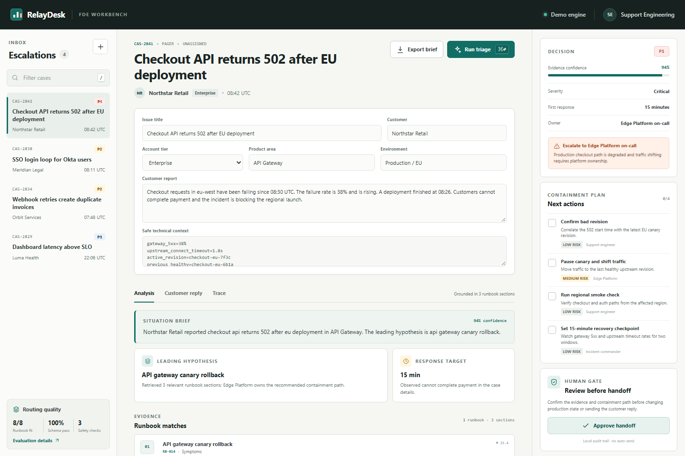
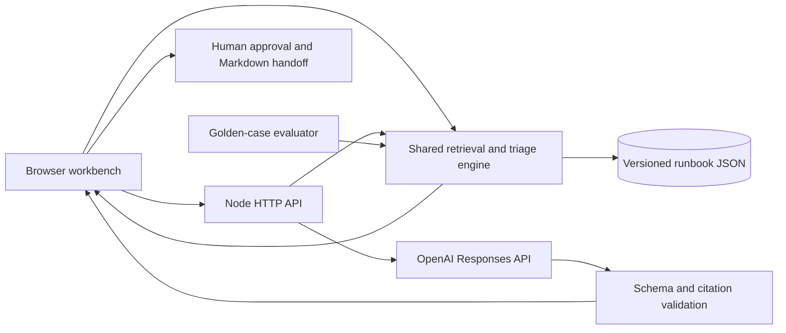

# RelayDesk

AI escalation workbench for forward-deployed support engineering.



RelayDesk turns a messy customer escalation into a grounded incident brief, a safe containment plan, a cited runbook trail, and a customer-ready response. Every recommendation stays behind a human approval gate.

The demo runs without an API key. The same analysis engine runs in the browser and on the Node server. When `OPENAI_API_KEY` is configured, the server can use the OpenAI Responses API and falls back to deterministic triage if the provider is unavailable.

## Why This Project

Forward-deployed engineers and AI application developers need more than a chat box. They need to ship a narrow workflow that handles messy input, connects knowledge to decisions, measures output quality, and keeps a human in control.

RelayDesk shows that full path:

- Problem framing for a customer-facing support workflow.
- Retrieval-grounded recommendations with explicit source IDs.
- Structured output and local schema validation.
- Safe containment steps with risk and ownership.
- Human approval and exportable handoff notes.
- Golden-case evaluation and focused automated tests.
- Zero-dependency local deployment that still supports a live model path.

## Product Walkthrough

1. Select an escalation from the queue.
2. Review or edit the customer report and safe technical context.
3. Run triage to retrieve relevant runbook sections.
4. Check the hypothesis, severity, containment plan, and escalation owner.
5. Review the customer response in the Reply tab.
6. Check completed actions and approve the handoff.
7. Export a Markdown case brief.

The sample queue covers gateway rollbacks, SAML failures, webhook duplicates, dashboard latency, and other common B2B support cases.

## Run Locally

Requires Node.js 20 or newer.

```powershell
npm start
```

Open `http://127.0.0.1:4173`.

There are no runtime dependencies to install.

Run verification:

```powershell
npm test
npm run eval
```

## Optional Live Model

Create `.env` from `.env.example`:

```text
OPENAI_API_KEY=your_key_here
OPENAI_MODEL=gpt-4.1-mini
PORT=4173
```

The server uses the Responses API with a strict JSON schema. Unknown citations or invalid model output cause a deterministic fallback. The browser never receives the API key.

The public browser demo remains functional without a key and can also run from a static GitHub Pages host.

To enable the included static demo deployment, open repository settings and set Pages to `GitHub Actions`. The workflow deploys the `public` directory on each push to `main`.

For a container-based server deployment:

```powershell
docker build -t relaydesk .
docker run --rm -p 4173:4173 relaydesk
```

## Architecture



The retrieval and deterministic triage engine lives in `public/js/engine.js` so the demo works offline. The server imports the same engine instead of maintaining a second implementation.

## Evaluation

Current recorded result from `npm run eval`:

| Metric | Result |
| --- | ---: |
| Golden cases | 8 |
| Top-1 runbook routing | 8/8 |
| Severity accuracy | 8/8 |
| Schema validity | 8/8 |
| Safety checks | 8/8 |
| Median demo latency | 12 ms |

These are deliberately small synthetic gates. They prove the deterministic path and establish a regression harness. They are not a claim of production model quality.

See [Evaluation](docs/EVALUATION.md) for limits and next steps.

## Reliability And Safety

- Strict response schema.
- Citation allowlist validation for live output.
- Deterministic fallback if the model call fails.
- Request size limit and per-process rate limit.
- Security headers, no-store API responses, and static path traversal protection.
- Customer replies warn against sending credentials, session cookies, SAML assertions, and customer payloads.
- Production-changing actions remain recommendations until a human approves the handoff.
- No message is sent automatically.

## Project Map

```text
public/
  index.html             Workbench UI
  styles.css             Responsive application design
  js/engine.js           Retrieval, triage, citations, validation
  js/knowledge.js        Synthetic runbook knowledge base
  js/cases.js            Sample escalations
src/
  server.js              Zero-dependency HTTP server and API
  provider.js            Optional OpenAI Responses API adapter
evals/cases.json         Golden evaluation set
scripts/evaluate.js      Evaluation gates
tests/                   Engine and API tests
docs/                    Case study and interview material
```

## Tradeoffs

- Lexical BM25 retrieval is inspectable and deterministic, but it does not handle semantic paraphrases as well as an embedding index.
- The synthetic runbook set is small enough to ship with the app. Production ingestion, versioning, and tenant isolation are not included.
- Browser state uses `localStorage`. A multi-user deployment needs authentication, durable case storage, and a real audit log.
- The in-memory rate limiter is appropriate for a local demo, not a distributed production service.

## Next Production Step

Connect the same contract to a tenant-scoped knowledge ingestion job and a case system such as Zendesk or Jira. Keep the current citation validation and human gate. Add trace export and reviewer feedback before expanding model autonomy.

## Documentation

- [Case study](docs/CASE_STUDY.md)
- [Evaluation record](docs/EVALUATION.md)
- [Interview demo script](docs/DEMO_SCRIPT.md)
- [Chinese resume bullets](docs/RESUME_BULLETS_ZH.md)
